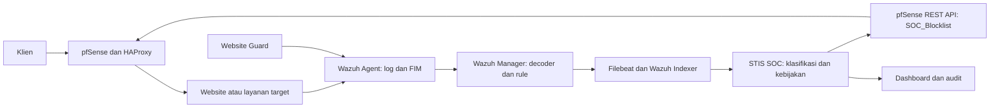

# PERANCANGAN DAN IMPLEMENTASI SISTEM DETEKSI DAN MITIGASI OTOMATIS SERANGAN WEB DI POLITEKNIK STATISTIKA STIS

**STIS SOC** adalah prototipe pemantauan dan respons keamanan web: Wazuh mendeteksi kejadian, dashboard SOC mengelola alert dan keputusan, lalu pfSense memblokir IP yang memenuhi kebijakan. Website Guard memantau perubahan file dan indikasi konten berbahaya untuk investigasi operator.

## Identitas

| Keterangan | Isi |
| --- | --- |
| Nama | Jordan Dwi Febriyanto |
| NIM | 222212683 |
| Program studi | Komputasi Statistik |
| Perguruan tinggi | Politeknik Statistika STIS |
| Judul skripsi | Perancangan dan Implementasi Sistem Deteksi dan Mitigasi Otomatis Serangan Web di Politeknik Statistika STIS |
| Sipadu | Bukan skripsi Sipadu; tautan branch Sipadu tidak berlaku |

Repositori memuat kode artefak, pemodelan berbasis aturan, dataset dummy publik, dokumentasi sistem, dan panduan penggunaan. Nama project GitLab menggunakan judul skripsi.

## Isi pengumpulan

| Komponen | Lokasi |
| --- | --- |
| Kode artefak aplikasi | [Backend](backend/), [frontend](frontend/), [Website Guard](website_guard/) |
| Kode pemodelan | [Peta pemodelan dan evaluator](modelling/README.md), [rule/decoder Wazuh](config/wazuh/README.md) |
| Dataset | [12 baris sintetis dan kamus data](datasets/README.md) |
| Dokumentasi sistem | [STIS_SOC.md](STIS_SOC.md) |
| Panduan penggunaan | [Panduan operator](docs/PANDUAN_PENGGUNAAN.md) |
| Instalasi, operasi, dan evaluasi | [Indeks dokumentasi](docs/README.md) |

Dataset nyata, log kampus, dan database lokal **tidak disertakan** karena tidak dinyatakan terbuka untuk publik. Dataset dummy dibuat dari nol, menggunakan IP/hostname contoh dan penanda masking. Data ini untuk demonstrasi dan reproduksi kebijakan; bukan hasil pengujian skripsi.

## Cara kerja



Respons berlangsung setelah kejadian. Status `BLOCKED` perlu diverifikasi dengan alias firewall dan koneksi baru yang melewati pfSense. Temuan perubahan file tidak otomatis mengidentifikasi IP pelaku dan tidak dipulihkan otomatis.

Fitur utama: ringkasan dashboard, filter/detail alert, block/unblock IP, audit, inventaris Wazuh yang dapat dibaca, pengaturan integrasi/auto-response, serta penghapusan alert dengan pratinjau dan konfirmasi admin. Sebanyak 37 rule lokal menangani pola seperti brute force, SQLi, Shellshock, traversal, XSS, SSRF, probe webshell, reputasi IP, dan temuan host/file; beberapa memerlukan telemetry atau modul Wazuh tambahan.

## Struktur file

```text
.
├── backend/
│   ├── app/
│   │   ├── api/             # Endpoint autentikasi, alert, audit, settings, inventaris
│   │   ├── models/          # Skema SQLite; termasuk tabel arsip kompatibilitas
│   │   ├── services/        # Integrasi, keputusan respons, scheduler, retensi
│   │   └── utils/           # Klasifikasi, validasi, waktu, saran penanganan
│   ├── tests/              # Unittest dengan mock dan database memory
│   ├── check_*.py          # Diagnosis integrasi/lab
│   ├── init_db.py          # Buat tabel, akun awal, dan settings
│   ├── demo_dataset.py     # Pembaca CSV dummy
│   ├── seed_demo_data.py   # Isi instance/demo.db, tanpa scheduler
│   ├── run.py              # Entry API; --demo untuk preview terpisah
│   └── requirements*.txt   # Dependensi Python dan versi hasil verifikasi
├── frontend/
│   ├── src/               # Halaman React, komponen, sesi, layanan API
│   └── package-lock.json  # Versi dependensi npm yang direplikasi dengan npm ci
├── config/wazuh/           # Rule XML, decoder XML, dan daftar CDB contoh
├── website_guard/          # Scanner file, systemd service dan timer
├── modelling/              # Dokumentasi model aturan dan evaluasi offline
├── datasets/dummy/         # CSV sintetis publik 12 baris
├── docs/                   # Panduan instalasi, penggunaan, dan pengujian
├── examples/               # Helper PHP khusus pengujian lab
├── scripts/                # Validasi repo, generator, pengujian, pemeliharaan
├── setup_ubuntu.sh          # Instalasi dependensi aplikasi lab
├── start_soc.sh             # Mulai Flask dan Vite di Ubuntu
├── stop_soc.sh              # Hentikan proses aplikasi milik instalasi ini
├── soc_processes.sh         # Pemeriksaan kepemilikan proses
├── update_from_vm_share.sh  # Sinkronisasi source tanpa menimpa database/.env
├── cleanup_ubuntu.sh        # Pelepasan aplikasi khusus layout lab /root
├── STIS_SOC.md              # Arsitektur dan dokumentasi teknis sistem
└── README.md
```

## Demo lokal

Prasyarat: Python **3.13** untuk jalur verifikasi proyek, Node.js **22**, npm, dan Git. Python 3.15 prarilis pada lingkungan lama belum menjadi target verifikasi. Demo tidak memerlukan Wazuh/pfSense.

PowerShell di root clone:

```powershell
py -3.13 -m venv .venv
.\.venv\Scripts\python.exe -m pip install -r backend/requirements.txt
Copy-Item backend/.env.example backend/.env
# Edit backend/.env: ganti SECRET_KEY dengan nilai acak unik.
.\.venv\Scripts\python.exe -c "import secrets; print(secrets.token_hex(32))"
cd backend
..\.venv\Scripts\python.exe seed_demo_data.py
..\.venv\Scripts\python.exe run.py --demo
```

Gunakan `Copy-Item` hanya pada instalasi baru; pertahankan `.env` yang sudah diisi. Jika virtual environment lama memakai Python berbeda, buat `.venv-demo` dengan Python 3.13 lalu sesuaikan path interpreter. Jangan menggunakan ulang paket binary dari interpreter lain.

Buka terminal kedua di root clone:

```powershell
npm.cmd --prefix frontend ci
npm.cmd --prefix frontend run dev
```

Buka **http://127.0.0.1:5173/**; akun demo awal **admin / admin123**. Seeder selalu memakai `backend/instance/demo.db`, tanpa polling otomatis dan tanpa menulis ke `soc.db`. Untuk mengganti data demo, hentikan backend lalu jalankan `seed_demo_data.py --reset`. Gunakan `run.py --demo` agar dashboard membuka database demo yang sama.

Di Linux, buat lingkungan dengan `python3 -m venv .venv`, pasang dependensi menggunakan `.venv/bin/python`, lalu jalankan perintah seed/run dari `backend/` dengan `../.venv/bin/python`. Mulai frontend dengan npm pada terminal terpisah.

## Lab terintegrasi

Ikuti [Panduan 01](docs/PANDUAN_01_INSTALASI_PFSENSE_WAZUH_DAN_STIS_SOC.md). Lab contoh memakai UbuntuServer Wazuh/SOC `10.10.10.20`, pfSense `10.10.10.1`, target `10.10.10.30`, dan host-only SOC `192.168.1.10`. Alamat dapat disesuaikan dengan lingkungan sendiri.

Pada direktori source Ubuntu:

```bash
bash setup_ubuntu.sh
bash start_soc.sh
# Untuk berhenti:
bash stop_soc.sh
```

Installer aplikasi tidak memasang seluruh Wazuh/pfSense secara otomatis. Pada clone baru, buat `backend/.env` dari contoh dan isi secret unik sebelum memulai aplikasi. Akun awal operasional `admin / admin123` dibuat hanya jika belum ada; ganti password mengikuti Panduan 01 bagian 16.8. Auto-response awal mati, level 10, polling 60 detik, usia maksimum 600 detik; kredensial integrasi diisi melalui Settings.

Untuk source clone di luar shared folder, skrip Manager menerima lokasi eksplisit:

```bash
sudo SOC_SOURCE=/path/clone SOC_TARGET=/path/instalasi bash scripts/testing/prepare_manager.sh --no-tests
```

Sumber dan instalasi tujuan harus merupakan direktori berbeda; ikuti panduan untuk backup dan validasi Manager. Menyunting source lokal belum memperbarui konfigurasi VM.

## Validasi dan evaluasi

Dengan lingkungan Python backend aktif, jalankan dari root:

```bash
python scripts/check_repository.py
python scripts/run_backend_tests.py
python modelling/evaluate_response.py --output reports/evaluation.json
npm --prefix frontend test
npm --prefix frontend run build
```

Di PowerShell gunakan path interpreter `.venv\Scripts\python.exe` dan `npm.cmd` jika lingkungan belum diaktifkan. Pemeriksa kandidat unggahan memerlukan repositori Git yang sudah diinisialisasi; pengujian backend dan frontend dapat dijalankan tanpa Git. Uji firewall/Manager/target pada VM dilakukan terpisah menurut [Panduan 05](docs/PANDUAN_05_UJI_FUNGSIONAL_TARGET_NYATA_DAN_DEMO.md).

## Batas implementasi

Aplikasi adalah prototipe lab: Flask satu proses, Vite, SQLite, dan APScheduler. Ia belum mencakup WAF inline, pemulihan defacement otomatis, jaminan seluruh alert Indexer tersalin, auto-block IPv6, enkripsi kredensial database, RBAC menyeluruh, atau scheduler multiworker. API lab menerima sertifikat mandiri tanpa verifikasi TLS. Source portal akademik/website STIS, konfigurasi VM aktif, dataset privat, dan hasil eksperimen nyata tidak disertakan.

Referensi detail dan panduan tersedia di [indeks dokumentasi](docs/README.md).
