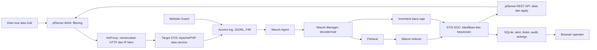
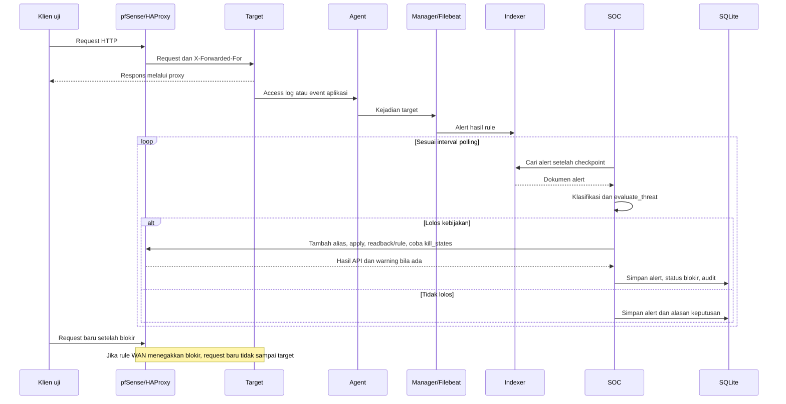
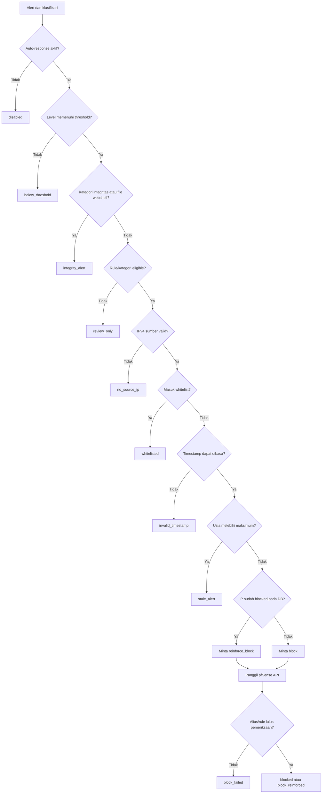
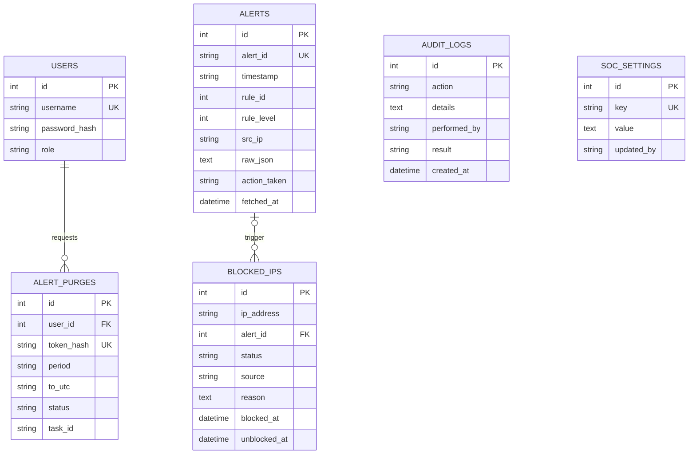

# STIS SOC - Dokumentasi sistem

Dokumen ini menjelaskan arsitektur, deteksi, keputusan respons, basis data, API, dan operasi STIS SOC. Lingkungan acuan adalah prototipe lab pada VM Ubuntu. Mulai dari bagian 1 sampai 4 untuk gambaran sistem, bagian 5 sampai 8 untuk implementasi, dan bagian 11 untuk peta source.

## Daftar isi

1. [Gambaran sistem dan istilah](#1-gambaran-sistem-dan-istilah)
2. [Arsitektur, jaringan, dan spesifikasi](#2-arsitektur-jaringan-dan-spesifikasi)
3. [Fitur dan batas tanggung jawab](#3-fitur-dan-batas-tanggung-jawab)
4. [Deteksi dan kebijakan respons](#4-deteksi-dan-kebijakan-respons)
5. [Alur data dan kode](#5-alur-data-dan-kode)
6. [Basis data dan konfigurasi](#6-basis-data-dan-konfigurasi)
7. [API dan antarmuka](#7-api-dan-antarmuka)
8. [Operasi, pembaruan, dan pemulihan](#8-operasi-pembaruan-dan-pemulihan)
9. [Pengujian kode](#9-pengujian-kode)
10. [Verifikasi integrasi](#10-verifikasi-integrasi)
11. [Peta source untuk pengembang](#11-peta-source-untuk-pengembang)
12. [Keterbatasan dan pekerjaan lanjutan](#12-keterbatasan-dan-pekerjaan-lanjutan)
13. [Rujukan panduan operasional](#13-rujukan-panduan-operasional)
14. [Rujukan kode aktual dan dataset](#14-rujukan-kode-aktual-dan-dataset)

## 1. Gambaran sistem dan istilah

### 1.1 Masalah yang ditangani

Website dapat menerima upaya login berulang, permintaan dengan pola SQL injection, pencarian file rahasia, atau pemindaian endpoint administratif. Selain itu, file website dapat berubah tanpa izin, misalnya disisipi promosi perjudian atau pinjaman daring. Data kejadian biasanya tersebar pada log web, aplikasi, sistem operasi, dan firewall.

STIS SOC menyatukan proses melihat kejadian dan menindaklanjutinya. Wazuh mengumpulkan serta memeriksa kejadian. SOC menyajikan alert, memutuskan apakah IP boleh diblokir, dan mencatat tindakannya. pfSense menerapkan pemblokiran jaringan pada jalur yang dikonfigurasi.

Tujuan praktisnya adalah memperpendek penanganan pola yang telah dikenal dan menyediakan jejak tindakan yang dapat diperiksa. Sistem tidak dapat menyatakan seluruh website bebas kerentanan hanya karena tidak ada alert.

### 1.2 Istilah yang digunakan

| Istilah | Arti sederhana dan penggunaan dalam sistem |
| --- | --- |
| Server target | Komputer yang menjalankan website atau layanan yang dilindungi |
| Agent | Program Wazuh pada target yang mengirim data ke Manager |
| Manager | Komponen Wazuh yang memproses log dengan decoder dan rule |
| Decoder | Penerjemah baris log menjadi field, misalnya akun dan IP sumber |
| Rule | Kondisi yang menentukan jenis kejadian dan tingkat peringatan |
| Alert | Peringatan hasil rule; satu request dapat menghasilkan beberapa alert |
| Indexer | Penyimpanan/pencarian alert Wazuh berbasis OpenSearch |
| SOC | Pusat pemantauan dan respons; pada proyek ini diwujudkan sebagai aplikasi web |
| FIM | File Integrity Monitoring: pemantauan perubahan file |
| Baseline | Catatan kondisi file yang sudah diperiksa dan dianggap sah |
| Hash | Sidik isi file; perubahan isi menyebabkan hash berbeda |
| Alias firewall | Nama daftar alamat yang dipakai rule pfSense, yaitu `SOC_Blocklist` |
| Auto-block | Penambahan IP ke alias setelah alert lolos kebijakan SOC |
| Threshold | Ambang level minimum untuk tindakan; bukan hitungan request |
| Frequency/timeframe | Hitungan dan jendela waktu korelasi rule Wazuh |
| Whitelist/daftar putih | IP atau subnet yang dikecualikan dari blokir melalui SOC |
| State | Catatan koneksi aktif pada firewall; dapat berbeda dari koneksi baru |
| Polling | Pengambilan alert secara berkala, bukan pemrosesan inline setiap paket |
| Probe | Permintaan untuk mencoba/mencari suatu celah; belum membuktikan eksploitasi berhasil |
| False positive | Kejadian sah yang salah dianggap ancaman atau salah diblokir, sesuai ukuran yang didefinisikan |

### 1.3 Apa yang disediakan proyek

Repositori menyediakan aplikasi SOC, rule/decoder lokal Wazuh, contoh daftar CDB, Website Guard, helper simulasi PHP, skrip instalasi/pembaruan, diagnosis, pengujian, dan dokumentasi.

Repositori tidak menyediakan source portal akademik STIS. Website demo `/var/www/web1`, file `process_login.php`, VirtualHost `web1.conf`, konfigurasi pfSense aktif, dan `ossec.conf` aktif berada pada VM masing-masing. Contoh konfigurasi dalam panduan adalah petunjuk untuk membuat/mengubah berkas tersebut, bukan klaim bahwa berkas itu ada di source proyek.

Dataset yang disertakan adalah contoh sintetis. Database operasional, log privat, dan konfigurasi aktif VM tidak disertakan.

## 2. Arsitektur, jaringan, dan spesifikasi

### 2.1 Komponen dan aliran utama



Jalur request dan jalur telemetry berbeda. Request klien melewati firewall/proxy menuju website. Log dari website baru diproses sesudah kejadian. Karena itu request pertama atau request yang datang sebelum siklus SOC selesai masih dapat mencapai aplikasi; pencegahan pada aplikasi tetap diperlukan.

### 2.2 Topologi lab yang dipertahankan

| Mesin | Alamat/adapter | Fungsi |
| --- | --- | --- |
| Windows Host | Folder proyek dan browser | Mengedit source; mengakses dashboard |
| pfSense WAN | Bridged, DHCP mengikuti jaringan | Jalur klien luar/penguji |
| pfSense LAN | `10.10.10.1/24` | Gateway internal, HAProxy ke target, REST API dari SOC |
| pfSense OPT1 | `192.168.1.20/24` host-only | WebGUI untuk host |
| UbuntuServer | `10.10.10.20/24` internal | Manager, Indexer, Dashboard Wazuh, Filebeat, SOC |
| UbuntuServer host-only | `192.168.1.10/24` | Akses SOC dari Windows |
| Server STIS | `10.10.10.30/24` internal | Website/Agent |
| Server STIS host-only | `192.168.1.30/24` | Administrasi dari host bila adapter tersebut dipasang |
| Kali | Bridged di sisi WAN | Klien simulasi |
| Adapter NAT Ubuntu | DHCP | Mengunduh paket; bukan jalur bukti pemblokiran WAN |

**Alamat dashboard lab: http://192.168.1.10:5173/**. Backend mendengarkan port 5000; frontend memproxy permintaan `/api` ke backend lokal. Tidak perlu mengubah URL dashboard ketika WAN pfSense berubah jika jaringan host-only tetap sama.

Alamat WAN dalam contoh lama, seperti `192.168.18.99` atau `192.168.0.110`, bukan IP tetap sistem. Isi `LAB_WAN` menggunakan alamat WAN pfSense saat sesi uji. IP sumber diproses dinamis dari log; tidak perlu menanam IP Kali di rule deteksi.

### 2.3 Port dan kredensial

| Jalur | Port/protokol | Kredensial |
| --- | --- | --- |
| Windows → frontend SOC | HTTP 5173 | Akun login SOC |
| Frontend Vite → backend | HTTP 5000 | Sesi cookie SOC |
| SOC → Manager API | HTTPS 55000 | User API Wazuh; JWT setelah autentikasi |
| SOC → Indexer | HTTPS 9200 | Akun Indexer, berbeda dari user API |
| Agent → Manager | TCP 1514 | Enrollment/identitas Agent |
| Enrollment Agent | TCP 1515 | Mekanisme pendaftaran Wazuh |
| SOC → pfSense API | HTTPS sesuai WebGUI/API, lazimnya 443 | `X-API-Key` pfREST |
| Klien → demo | HTTP 80 WAN → HAProxy → Apache | Akun aplikasi bila endpoint memerlukan |
| Administrasi SSH/SCP | TCP 22 | Akun Linux target, misalnya `vboxuser` |

Password SOC bukan password Wazuh, pfSense, token lab, atau SSH. Akun SOC awal `admin/admin123` hanya dibuat ketika belum ada. Password SOC tersimpan sebagai hash bcrypt dan tidak dapat ditampilkan kembali sebagai teks; pemulihan dilakukan dengan menetapkan password baru pada database yang benar.

### 2.4 Perangkat lunak dan kapasitas

| Komponen | Acuan source/lab |
| --- | --- |
| Flask | 3.1.0; API menggunakan Flask-RESTX 1.3.0 |
| SQLAlchemy/SQLite | Flask-SQLAlchemy 3.1.1; database lokal aplikasi |
| Autentikasi SOC | Flask-Login 0.6.3, Flask-Bcrypt 1.0.1 |
| Scheduler | APScheduler 3.10.4 |
| HTTP integrasi | Requests 2.32.3 |
| Frontend | React 18.3, React Router 6, Vite 6, Tailwind CSS 3 |
| Python | Python 3; script Linux memakai sintaks modern, acuan Ubuntu 22.04/24.04 |
| Node.js | Installer memasang Node 22 jika runtime belum cocok; paket aktual mengikuti lockfile |
| Wazuh | Acuan lab 4.14.7; catat versi aktual Manager/Agent pada VM |
| pfSense/pfREST | Acuan lab CE 2.8.1 dan REST API v2; paket komunitas harus cocok dengan versi pfSense |
| Apache/PHP | Ada pada target, bukan dependensi SOC langsung |
| Auditd/VirusTotal | Tambahan sesuai modul yang digunakan; VirusTotal memerlukan key operator |

Rekomendasi VM pada panduan: UbuntuServer 4 vCPU/8 GB RAM/50 GB disk, STIS 2 vCPU/4 GB/30 GB, pfSense 2 vCPU/2 GB/16 GB, Kali 2 vCPU/4 GB/30 GB. Ini saran lab, bukan pengukuran kebutuhan minimum maupun spesifikasi hardware yang dibuktikan terpasang.

### 2.5 Mempertahankan IP klien

HAProxy membuat koneksi baru ke Apache. Tanpa penyesuaian, Apache melihat IP pfSense LAN. Konfigurasi HTTP yang dipakai:

```haproxy
http-request set-header X-Forwarded-For %[src]
```

Pada Apache:

```apache
RemoteIPHeader X-Forwarded-For
RemoteIPInternalProxy 10.10.10.1
LogFormat "%a %l %u %t \"%r\" %>s %b \"%{Referer}i\" \"%{User-Agent}i\"" stis_soc_combined
```

Header diganti oleh HAProxy, bukan menyalin nilai palsu dari klien. Apache hanya mempercayai proxy tersebut. `%a` menghasilkan IP klien untuk log; aplikasi membaca `REMOTE_ADDR` yang telah disesuaikan modul. Jangan menggunakan header mentah dari sembarang pengirim sebagai identitas IP.

Konfigurasi ini berlaku pada HTTP/SSL offloading. TLS passthrough mode TCP tidak membaca header HTTP dan membutuhkan rancangan lain; panduan tidak menganggap PROXY protocol telah dipasang.

## 3. Fitur dan batas tanggung jawab

### 3.1 Fitur untuk tim IT

| Fitur aktif dalam source | Perilaku |
| --- | --- |
| Dashboard | Statistik data SOC, grafik, severity, IP teratas, alert terbaru |
| Alerts | Filter jenis/level, pencarian deskripsi/rule, detail event asli dan lokasi sasaran |
| Auto-response | Menilai alert dan meminta blokir pfSense secara bersyarat |
| Block manual | Memblokir IPv4 dengan alasan; API menolak IP pada whitelist |
| Unblock/block ulang | Mengubah alias dan status riwayat melalui SOC |
| Sync blokir | Menganggap alias pfSense sebagai sumber status saat menyelaraskan riwayat |
| Hapus riwayat blokir | Menghapus baris yang sudah unblocked dan dipilih; select all pada halaman yang terlihat |
| Audit | Menampilkan tindakan beserta hasil dan error yang tercatat |
| Inventaris | Membaca Agent, paket, service, port, log collector dan FIM; beberapa bagian dapat gagal karena versi/izin |
| Settings | Menyimpan koneksi/kebijakan serta memperbarui jadwal polling dalam proses yang berjalan |
| Notifikasi | Enam alert terakhir level ≥7, diperbarui 30 detik; status dibaca tersimpan per akun di browser |
| Profil | Informasi sesi, login terakhir, Settings, Audit Log, keluar |
| Hapus alert lama | Admin, pratinjau dan verifikasi password/frasa, penghapusan Indexer lalu salinan SOC |
| Website Guard | Deteksi hash/perubahan/konten; menampilkan path dan indikator |

Halaman utama yang dilindungi sesi ada enam: Dashboard, Alerts, Blocked IPs, Audit Log, Inventaris Wazuh, Settings. Login merupakan halaman tambahan. Tidak ada halaman CRUD server/website aktif.

### 3.2 Temuan tanpa IP tetap dapat ditindaklanjuti

FIM mengetahui file yang berubah. Auditd dapat mengetahui proses/pengguna. VirusTotal dapat menilai reputasi hash. Data tersebut tidak otomatis menunjukkan IP pengubah file.

Detail insiden memberi lokasi dan saran: simpan salinan serta hash, batasi eksekusi file, isolasi host/backend bila diperlukan, telusuri log upload/auth/proses, pulihkan backup bersih, tutup celah, dan rotasi kredensial yang bocor. Operator melakukan langkah ini secara manual. Jangan menyebut Website Guard sebagai karantina atau pemulihan otomatis.

### 3.3 Fitur lama dan fitur yang belum tersedia

Model `monitored_assets` dan `monitored_servers` tetap ada untuk menjaga data instalasi lama. `incident.py` dapat memakai metadata arsip untuk menjelaskan alert lama, tetapi API inventaris tidak memperbarui model-model itu.

Tidak tersedia: pendaftaran Agent dari dashboard, CRUD server/website, pemasangan service, pembuatan DNS/VirtualHost/HAProxy otomatis, katalog semua domain otomatis, pemeriksaan uptime aktif, WAF inline, pemulihan defacement otomatis, penghapusan file malware otomatis, deteksi Docker/RDP khusus lab ini, serta blokir IPv6 melalui mesin keputusan.

RDP tidak wajib pada Ubuntu; SSH cukup untuk administrasi lab. Modul Docker dikecualikan sesuai cakupan proyek.

## 4. Deteksi dan kebijakan respons

### 4.1 Dua ambang yang berbeda

Wazuh menentukan **kapan suatu pola/correlasi menghasilkan alert dan levelnya**. SOC menentukan **apakah alert tersebut boleh memicu blokir**. Mengubah threshold SOC tidak mengubah jumlah kejadian pada rule Wazuh.

Contoh XSS: rule awal level 6 dapat muncul untuk request HTTP 200 atau non-200. Rule korelasi `100470` level 10 memakai grup `stis_xss_probe`, frekuensi 5, jendela 60 detik, dan IP yang sama. Pada threshold SOC 10, rule awal belum memblokir; rule korelasi menjadi kandidat.

Untuk kategori yang terdaftar sebagai layak blokir, menurunkan threshold dapat membuat rule awal memicu tindakan. SSRF tunggal `100480` tetap tidak layak auto-block meskipun threshold diturunkan; `can_auto_block` khusus mengizinkan SSRF `100481`.

**Hitungan korelasi adalah event yang cocok menurut Wazuh, bukan jumlah alert pada UI.** Nilai XML adalah acuan nominal. Jumlah request pemicu yang benar-benar teramati harus ditulis bersama versi Wazuh, kolektor yang aktif, dan bukti baris log. Unblock tidak mereset korelasi.

### 4.2 Matriks kategori pada threshold contoh 10

| Kategori | Rule/level awal → pemicu | Frequency/timeframe nominal | Respons |
| --- | --- | --- | --- |
| SSH brute force | `100001` L5 → `100002` L10; rule bawaan `5712/5763` juga dikenali | 5/60 detik | Kandidat auto-block |
| Login web legacy | `100101` L5 → `100102` L10 | 5/60 | Kandidat auto-block |
| Login JSON aplikasi/service | `100500` L5 → `100501` L10 | 5/60 | Kandidat auto-block |
| SQLi legacy/Apache/JSON | `100200/100201/100202/100510` L12 | Tidak mensyaratkan korelasi berulang pada rule lokal ini | Kandidat auto-block |
| Probe file webshell | `100400` L7 → `100401` L10 | 5/120 | Kandidat setelah korelasi |
| WordPress | `100410` L6 → `100411` L10 | **8/120** | Kandidat setelah korelasi |
| Scanner User-Agent | `100420` L5 → `100421` L10 | **10/60** | Kandidat setelah korelasi; pertimbangkan scanner resmi |
| File sensitif | `100430` L12 | Tunggal | Kandidat auto-block |
| RCE/command probe | `100440` L12 | Tunggal | Kandidat auto-block |
| Recon/enumerasi | `100450` L6 → `100451` L10 | 5/120 | Kandidat setelah korelasi |
| Traversal/LFI | `100460` L12 | Tunggal | Kandidat auto-block |
| XSS | `100468/100469` L6 → `100470` L10 | 5/60 | Kandidat setelah korelasi |
| SSRF indikatif | `100480` L8 → `100481` L10 | **5/3600** | Tunggal untuk ditinjau; berulang kandidat blokir |
| Shellshock | `100490` L12; `31166–31169` bawaan dikenali | Tunggal untuk rule lokal | Kandidat pada level memenuhi ambang |
| HTTP 4xx generik berulang | `31151` bawaan | Ikuti ruleset Wazuh terpasang | Kandidat kompatibilitas, dapat false positive |
| Reputasi IP operator | `100600` L12 | IP ada di CDB aktif | Kandidat auto-block |
| Konten judol/pinjol | `100300` L12 | Pemindaian file | Investigasi, tanpa auto-block |
| Perubahan file Guard | `100301` L10, `100302` L12 | Added/modified/deleted/symlink | Investigasi integritas |
| FIM website | `100304` L10 | Path sesuai rule `/var/www/<nama>/...` | Investigasi integritas |
| Pola webshell dalam file | `100305` L14 | Pemindaian pola kode | Investigasi file, tanpa auto-block |
| Audit command | `100610` L10 | Auditd + executable dalam CDB | Review host |
| Proses jaringan | `100611` L8 | Snapshot proses tiap 120 detik | Review host; biasanya di bawah threshold |
| Rootcheck, VirusTotal, CVE | Rule/group bawaan Wazuh; misalnya `510/521`, `87105` | Modul terkait harus aktif | Investigasi host/file/paket |

SQLi POST tidak terbaca isinya hanya dari access log combined. Aplikasi perlu menghasilkan event deteksi JSON atau memakai sumber keamanan lain yang sesuai. Helper lab menghasilkan event uji; helper bukan mesin autentikasi atau database nyata.

Daftar CDB reputasi adalah daftar yang ditinjau operator, bukan feed otomatis. Scanner User-Agent, pencarian endpoint WordPress, dan pola nama webshell adalah indikator yang juga bisa muncul pada aktivitas resmi.

### 4.3 Urutan mesin keputusan yang sesuai kode

Urutan pada `ResponseEngine.evaluate_threat`:

1. Tentukan kategori dari rule ID, grup, dan deskripsi.
2. Jika auto-response mati: `disabled`.
3. Jika level di bawah threshold: `below_threshold`.
4. Jika kategori integritas/isi file: `integrity_alert`.
5. Jika kategori/rule tidak diizinkan auto-block: `review_only`.
6. Jika tidak ada IPv4 valid: `no_source_ip`.
7. Jika IP termasuk whitelist: `whitelisted`.
8. Jika timestamp tidak dapat dibaca: `invalid_timestamp`; jika terlalu lama: `stale_alert`.
9. Jika sudah diblokir: minta penguatan blokir; selain itu minta blokir baru.
10. Hasil API menentukan `blocked`, `block_reinforced`, atau `block_failed`.

Urutan ini penting. Temuan host level 10 biasanya menjadi `review_only` sebelum pemeriksaan IP. Temuan proses level 8 menjadi `below_threshold` pada threshold 10. Temuan integritas ketika auto-response mati dapat menjadi `disabled`, karena saklar diperiksa lebih dahulu.

Timestamp dinormalisasi ke format ISO yang mengenali `Z`, offset seperti `+0700`/`+07:00`, pecahan detik, dan sejumlah bentuk lain. Timestamp tanpa zona dianggap UTC oleh kode. Jam VM perlu disinkronkan; kode belum mempunyai penolakan tersendiri untuk timestamp yang berada di masa depan.

### 4.4 Default source dan konfigurasi sesi

| Key settings | Nilai awal pada database baru | Arti |
| --- | --- | --- |
| `auto_response_enabled` | `false` | Auto-block belum diaktifkan |
| `alert_threshold_level` | `10` | Minimum level |
| `polling_interval_seconds` | `60` | Interval pengambilan |
| `auto_response_max_alert_age_seconds` | `600` | Usia maksimal kejadian untuk tindakan |
| `whitelist_ips` | `127.0.0.1,10.10.10.0/24,192.168.1.0/24` | Perlindungan jaringan administrasi |
| `pfsense_alias_name` | `SOC_Blocklist` | Alias yang diubah |
| `pfsense_block_interface` | `wan` | Interface rule yang diperiksa |
| `pfsense_kill_states_on_block` | `true` | Mencoba membersihkan koneksi aktif |
| Password/API key integrasi | Kosong | Harus diisi operator |

Rentang validasi API: threshold 1–15, polling 10–86.400 detik, usia maksimum 60–86.400 detik. Nilai 30 detik dan 900 detik pada beberapa panduan demo adalah pilihan sesi, bukan default source. `apply_lab_defaults.py` menulis kembali topologi/threshold/polling/whitelist, mempertahankan password/API key, dan tidak mengaktifkan auto-response. Jangan menjalankannya setiap update bila Settings yang berbeda ingin dipertahankan.

### 4.5 Blokir, penguatan, dan pemulihan

`process_alerts` mengurutkan event menurut level lalu prioritas kategori. Ini membantu alert SQLi yang spesifik menjadi alasan blokir ketika satu request juga menghasilkan alert HTTP 4xx. Alert lebih kuat yang datang pada siklus berikut dapat meningkatkan alasan riwayat auto-block.

Keputusan `block_reinforced` meminta pfSense memeriksa/memperkuat IP yang sudah diblokir, bukan membuat baris riwayat baru setiap alert. Riwayat manual tidak otomatis diganti alasan oleh alert berikutnya.

Unblock menghapus IP dari alias. Block ulang mengaktifkan baris riwayat yang telah unblocked. Sync membaca alias untuk mengimpor IP yang belum tercatat atau menandai record yang sudah tidak ada sebagai unblocked.

Alert tertunda yang masih baru, paling banyak 100 kandidat per evaluasi, dapat diproses lagi setelah perubahan kebijakan atau kegagalan sementara. Karena itu perubahan whitelist/threshold/saklar dapat menindak event yang baru saja tersimpan sebelumnya.

### 4.6 Daftar seluruh rule lokal yang tersedia

Tabel ini disalin dari atribut XML yang ada. “Tunggal” berarti rule lokal tidak mempunyai atribut frequency; parent bawaan dapat mempunyai kondisi tambahan. Detail match/field/parent tersedia pada XML lampiran.

| Rule ID | Level | Frequency | Timeframe (detik) | IP sama pada korelasi | Deskripsi template |
| --- | ---: | ---: | ---: | --- | --- |
| `100001` | 5 | — | — | — | SSH authentication failure from $(srcip) |
| `100002` | 10 | 5 | 60 | Ya | SSH brute force attack from $(srcip) |
| `100100` | 3 | — | — | — | Website homepage access from $(srcip) |
| `100101` | 5 | — | — | — | Failed web authentication for $(dstuser) from $(srcip) |
| `100102` | 10 | 5 | 60 | Ya | Web login brute force attack from $(srcip) |
| `100103` | 3 | — | — | — | Successful web authentication for $(dstuser) from $(srcip) |
| `100200` | 12 | — | — | — | Possible SQL injection in web login from $(srcip) |
| `100201` | 12 | — | — | — | SQL injection attempt in web request from $(srcip) |
| `100202` | 12 | — | — | — | Encoded SQL injection attempt in web request from $(srcip) |
| `100300` | 12 | — | — | — | Website content injection detected: $(threat_type) in $(file_path) |
| `100305` | 14 | — | — | — | Possible webshell content in $(file_path) |
| `100301` | 10 | — | — | — | Website integrity change: $(change_type) $(file_path) |
| `100302` | 12 | — | — | — | Critical website integrity change: $(change_type) $(file_path) |
| `100304` | 10 | — | — | — | Website integrity change reported by Wazuh FIM: $(file) |
| `100400` | 7 | — | — | — | Possible webshell file probe at $(url) from $(srcip) |
| `100401` | 10 | 5 | 120 | Ya | Repeated webshell file probes from $(srcip) |
| `100410` | 6 | — | — | — | WordPress endpoint probe at $(url) from $(srcip) |
| `100411` | 10 | 8 | 120 | Ya | Repeated WordPress endpoint probes from $(srcip) |
| `100420` | 5 | — | — | — | Known scanner User-Agent from $(srcip) |
| `100421` | 10 | 10 | 60 | Ya | Repeated vulnerability scanner traffic from $(srcip) |
| `100430` | 12 | — | — | — | Sensitive configuration file requested: $(url) from $(srcip) |
| `100440` | 12 | — | — | — | High-confidence RCE endpoint probe: $(url) from $(srcip) |
| `100450` | 6 | — | — | — | Service enumeration at $(url) from $(srcip) |
| `100451` | 10 | 5 | 120 | Ya | Repeated service enumeration from $(srcip) |
| `100460` | 12 | — | — | — | Path traversal or local file inclusion probe at $(url) from $(srcip) |
| `100468` | 6 | — | — | — | XSS-shaped URL probe at $(url) from $(srcip) |
| `100469` | 6 | — | — | — | XSS-shaped URL probe returned HTTP 200 at $(url) from $(srcip) |
| `100470` | 10 | 5 | 60 | Ya | Repeated XSS probes from $(srcip) |
| `100480` | 8 | — | — | — | Possible SSRF target in request: $(url) from $(srcip) |
| `100481` | 10 | 5 | 3600 | Ya | Repeated SSRF-pattern URL probes from $(srcip) |
| `100490` | 12 | — | — | — | Shellshock payload in web request from $(srcip) |
| `100500` | 5 | — | — | — | Service authentication failed for $(dstuser) from $(srcip) |
| `100501` | 10 | 5 | 60 | Ya | Service brute force from $(srcip) |
| `100510` | 12 | — | — | — | Application-reported SQL injection at $(url) from $(srcip) |
| `100600` | 12 | — | — | — | Web request from a reviewed reputation-list IP: $(srcip) |
| `100610` | 10 | — | — | — | Suspicious command executed on agent: $(audit.exe) |
| `100611` | 8 | — | — | — | Suspicious network utility is running on agent |

## 5. Alur data dan kode

### 5.1 Dari request menjadi log

Apache menulis:

```text
/var/log/stis-soc/apache/<slug>.access.log
```

Aplikasi/service menulis satu objek JSON per baris:

```text
/var/log/stis-soc/apps/<slug>.jsonl
```

Website Guard tetap menggunakan nama path lama yang memang dipakai kode:

```text
/var/log/mini-soc/website_guard.log
/var/lib/mini-soc-website-guard/
```

Nama `mini-soc` pada path bukan fitur lama yang boleh dihapus sembarangan. Mengubahnya tanpa memperbarui scanner, unit systemd, dan kolektor Agent akan memutus aliran data.

Contoh bentuk event aplikasi, **bukan hasil uji nyata**:

```json
{"timestamp":"2026-10-05T10:00:00Z","event_type":"stis_auth_failed","srcip":"192.0.2.20","dstuser":"akun-uji","url":"/login","domain":"web1.stis.local","asset_name":"web1"}
```

Aplikasi harus mengisi `timestamp` waktu kejadian aktual dan mengambil IP dari jalur proxy yang dipercaya. Menambahkan event_type pada log tidak membuat aplikasi melakukan autentikasi atau menolak serangan; event harus mencerminkan pemeriksaan yang benar-benar terjadi.

### 5.2 Dari log menjadi field dstuser dan srcip

Untuk format login legacy:

```text
[2026-10-05 17:00:00] FAILED LOGIN USER=akun-uji IP=192.0.2.20
```

Decoder `web1-login` pada `config/wazuh/decoders/local_decoder.xml` memeriksa bagian `LOGIN|ATTEMPT`, lalu menangkap teks setelah `USER=` dan setelah `IP=`. `<order>dstuser,srcip</order>` memetakan hasil pertama ke `dstuser`, hasil kedua ke `srcip`.

Rule menulis `$(dstuser)` dan `$(srcip)` pada deskripsi. Itu substitusi field Wazuh, bukan variabel Bash, PHP, atau Python yang harus dideklarasikan di rule.

Untuk JSON, decoder bawaan Wazuh membaca key JSON. Rule lokal JSON pada versi lab dikaitkan ke parent `86600` dan kemudian memeriksa `event_type`. Nama parent “Suricata messages” tidak berarti Website Guard adalah Suricata. Jika hasil logtest hanya berhenti pada parent level 0, rule STIS yang diharapkan belum cocok. Contoh baris event harus ditempel saat `wazuh-logtest` terbuka, bukan langsung sebagai perintah shell.

### 5.3 Dari Manager ke Indexer dan SOC

Manager menghasilkan alert; Filebeat meneruskan ke indeks `wazuh-alerts-*`. `WazuhService.get_alerts` menggunakan akun Indexer untuk pencarian. Manager API dipakai untuk autentikasi/inventaris, bukan sebagai sumber utama dokumen alert.

`_parse_alert` mengambil `_id`, timestamp, rule ID/level/deskripsi/groups, Agent, IP, port, full log, dan JSON asli. IP sumber berasal dari field sumber (`data.srcip`, `srcip`, atau `data.src_ip`), bukan IP Agent sebagai pengganti pelaku.

`ResponseEngine.process_alerts` menyimpan alert dengan `alert_id` unik. Jika dokumen dengan ID sama telah ada, pengambilan ulang dilewati. Ini tidak menghilangkan duplikasi di sumber: dua pengiriman log menghasilkan dua dokumen berbeda dan tetap dapat dihitung dua kali.

### 5.4 Penjadwal dan batas pengambilan

`scheduler_service.py` menjalankan satu job polling dengan `max_instances=1` dan `coalesce=True`. Siklus awal dijadwalkan sekitar dua detik setelah start. Job penghapusan alert direkonsiliasi tiap 15 detik. Saat tugas penghapusan aktif, pengambilan alert dijeda.

Pengambilan pertama/manual: paling banyak 100 dokumen terbaru, urutan timestamp menurun. Pengambilan berikutnya: timestamp lebih besar dari checkpoint, urutan menaik, paling banyak 100 dokumen. Checkpoint diambil dari timestamp valid terbaru yang diproses.

Source belum memakai paginasi lengkap atau penanda tambahan untuk dokumen yang mempunyai timestamp sama. Event yang tertunda masuk indeks dengan waktu lama, event pada batas timestamp, dan histori sebelum pengambilan awal dapat tidak masuk SOC. Karena itu “polling berjalan” tidak membuktikan kelengkapan salinan seluruh alert.

Status scheduler disimpan pada key settings khusus dan diperlihatkan pada dashboard. Nilai `success` berarti siklus tidak melaporkan exception, bukan bukti semua serangan tertahan.

### 5.5 Integrasi pfSense

Alur update alias:

1. Baca `/api/v2/firewall/aliases`.
2. Temukan `SOC_Blocklist`; jika belum ada, kode dapat mencoba membuat alias.
3. Tambahkan IP melalui PATCH `/firewall/alias`, atau POST saat membuat.
4. POST `/firewall/apply`.
5. Baca ulang alias untuk memeriksa keanggotaan setelah perubahan.
6. Baca `/firewall/rules` untuk mencari rule Block/Reject aktif yang menggunakan alias pada interface configured.
7. Bila diaktifkan, DELETE `/firewall/states` dengan filter sumber IP untuk mencoba membersihkan state.

SOC tidak otomatis membuat rule WAN yang benar atau menjamin rule tersebut berada sebelum semua Pass. Operator memasang rule Block dengan sumber alias di atas rule Pass HAProxy. Pemeriksaan API hanya melihat konfigurasi; percobaan koneksi baru memberikan bukti penegakan.

Pembersihan state yang gagal disimpan sebagai peringatan sementara keberhasilan alias/rule dapat tetap menghasilkan status blokir sukses. Koneksi lama dan koneksi baru harus dievaluasi terpisah.

### 5.6 Lokasi sasaran dan saran mitigasi

`incident.describe_incident` mencari target dari field file/URL, syscheck path, VirusTotal file, executable Auditd, atau paket kerentanan. Bila field tersebut tidak ada, ia mencoba mengambil URL dari full log request.

Slug website berasal dari path log baku atau subdirektori web root. Domain berasal dari metadata JSON, URL absolut, atau arsip aset lama. Detail ini membantu investigasi, tetapi bukan inventaris otomatis seluruh domain.

`THREAT_GUIDANCE` memberikan saran per kategori. Saran adalah panduan operator, bukan command pemulihan yang dijalankan SOC.

### 5.7 Website Guard

Scanner membaca struktur direktori, menghitung SHA-256, dan membandingkan baseline. File konten dengan ekstensi yang didukung diperiksa dengan pola teks untuk judol/pinjol atau kode PHP seperti `eval(base64_decode(...))`. Pembacaan konten dibatasi 3 MiB; file yang lebih besar tetap dapat di-hash. Direktori tertentu seperti vendor/cache/logs diabaikan.

`init` dan `approve` membuat baseline dari kondisi saat itu. Baseline dapat terganti, sehingga jangan menjalankannya untuk sekadar “menghilangkan alert” ketika konten belum diperiksa. Konten mencurigakan ditolak sebagai baseline kecuali memakai `--force`; penggunaan force bukan rekomendasi pemulihan.

Temuan yang sama dan tidak berubah dideduplikasi melalui `seen.json`. Hasil `threats_found` dengan `new_events: 0` dapat berarti temuan sudah dilaporkan, bukan scanner rusak. Scanner tidak menghapus konten, mengisolasi host, atau memulihkan file.

Unit systemd memindai `/var/www` sebagai oneshot. Timer memakai jeda awal dua menit, interval 60 detik, dan random delay sampai 10 detik. Ini berbeda dari realtime FIM Wazuh dan berbeda lagi dari polling SOC.

### 5.8 Urutan satu request sampai keputusan blokir

Diagram ini menjelaskan urutan logis, bukan hasil pengukuran waktu. Jalur log dan polling berlangsung asynchronous.



### 5.9 Diagram keputusan untuk perancangan



Kegagalan membersihkan state perlu dicatat walaupun jalur pemeriksaan alias/rule lulus. Diagram ini tidak menyatakan bahwa semua jalur koneksi otomatis terlindungi.

## 6. Basis data dan konfigurasi

### 6.1 Database aktual

URI awal `sqlite:///soc.db` pada Flask menghasilkan file pada folder instance aplikasi, pada layout lab lazimnya `/root/backend/instance/soc.db`. `DATABASE_URL` dapat mengubah lokasinya.



Diagram menampilkan field inti; model source memuat field lengkap. Dua tabel legacy target juga masih ada.

| Tabel | Tujuan dan catatan |
| --- | --- |
| `users` | Akun SOC; password hash bcrypt |
| `alerts` | Salinan alert yang pernah diambil; rule, IP, data asli, keputusan, waktu pengambilan |
| `blocked_ips` | Riwayat blokir; IP tidak unik sepanjang histori; satu record dapat menunjuk satu alert pemicu |
| `audit_logs` | Tindakan dengan pelaksana, hasil, error, dan waktu |
| `soc_settings` | Satu baris per key, bukan satu baris seluruh konfigurasi |
| `alert_purges` | Persetujuan sekali pakai, cutoff, jumlah, status dan task penghapusan |
| `monitored_assets` | Arsip website/service versi CRUD lama; dapat membantu atribusi |
| `monitored_servers` | Arsip server versi lama; bukan sumber inventaris aktif |

`BlockedIP.alert_id` menunjuk primary key lokal `Alert.id`, bukan string ID dokumen Indexer. Satu alert dapat dirujuk beberapa riwayat blokir. Sebaliknya satu record blokir menyimpan satu pemicu terpilih, bukan relasi many-to-many semua alert IP itu.

Kategori ancaman/lokasi/saran dihitung oleh helper saat evaluasi/serialisasi; tidak semua field tampilan merupakan kolom database. `raw_json` menyimpan isi `_source`; kode belum menyimpan `_index` sebagai bagian identitas unik dokumen.

### 6.2 Inisialisasi dan migrasi

`create_app` menginisialisasi extension, models, namespace API, sesi, dan scheduler. `init_db.py` berjalan tanpa scheduler, membuat tabel yang belum ada dan settings default yang belum ada, lalu membuat admin hanya jika belum ada.

`db.create_all()` tidak mengganti struktur kolom tabel lama secara menyeluruh. Penambahan tabel baru seperti `alert_purges` dapat dibuat, tetapi perubahan skema existing memerlukan migrasi terencana. Jangan menghapus `soc.db` sebagai solusi umum tampilan blank; periksa log dan konfigurasi database dahulu.

### 6.3 Waktu dan statistik

Timestamp kejadian Wazuh disimpan setelah normalisasi. Waktu `fetched_at` adalah saat SOC mengambil data. `blocked_at` adalah pencatatan respons SOC, bukan packet capture waktu pertama firewall menolak paket. Waktu API diekspor dengan zona UTC; browser dapat menampilkan zona perangkat.

Statistik “hari ini” dan lini masa dashboard memakai `fetched_at` serta batas hari UTC. Impor alert lama pada hari ini dapat menambah hitungan hari ini. Untuk analisis trafik historis, gunakan timestamp kejadian/dataset target, bukan menafsirkan grafik pengambilan sebagai waktu asli serangan.

### 6.4 Secret dan hak akses

Password user SOC adalah hash. Password Manager API/Indexer dan key pfSense pada settings masih teks biasa di SQLite. GET Settings mengembalikan `********` untuk secret yang tidak kosong; PUT tidak menimpa secret dengan placeholder itu.

Mayoritas API mewajibkan sesi login. Penghapusan alert mempunyai pemeriksaan role admin khusus. Sistem belum menerapkan matriks izin per peran menyeluruh, enkripsi secret, MFA, atau hardening produksi. Klaim “secret tidak pernah bocor ke log” perlu pemeriksaan jalur error dan bukti, bukan hanya melihat masking pada form.

## 7. API dan antarmuka

### 7.1 Endpoint utama

Semua path di bawah berada di prefiks `/api`. Dokumentasi API tersedia pada `/api/docs`.

| Kelompok | Method/path | Fungsi |
| --- | --- | --- |
| Auth | POST `/auth/login`, POST `/auth/logout`, GET `/auth/me` | Sesi user |
| Dashboard | GET `/dashboard/stats`, `/timeline`, `/top-sources`, `/severity-distribution` | Ringkasan data |
| Alert | GET `/alerts`, GET `/alerts/<id>`, POST `/alerts/fetch` | Daftar/detail/pengambilan manual |
| Penghapusan | POST `/alerts/purge/preview`, POST `/confirm` di bawah `/alerts/purge` | Dua tahap persetujuan |
| Status hapus | GET `/alerts/purge/active`, GET `/alerts/purge/<id>` | Progress/error |
| Blokir | GET/POST `/blocked-ips` | Daftar/block manual |
| Unblock | DELETE `/blocked-ips/<id>` | Membuka blokir, bukan menghapus baris riwayat |
| Block ulang | POST `/blocked-ips/<id>/reblock` | Mengaktifkan riwayat unblocked |
| Hapus riwayat | DELETE `/blocked-ips/history` | Hanya ID unblocked terpilih |
| Sync | POST `/blocked-ips/sync` | Menyamakan status dengan alias pfSense |
| Audit | GET `/audit` | Daftar/filter |
| Settings | GET/PUT `/settings` | Koneksi/kebijakan |
| Diagnosis | POST `/settings/test-wazuh`, POST `/settings/test-pfsense` | Tes koneksi |
| Scheduler | GET `/settings/auto-response-status` | Status dan keputusan terbaru |
| Inventaris | GET `/assets/agents`, GET `/assets/agents/<id>/inventory` | Baca Wazuh; tanpa CRUD |

POST block menggunakan JSON `{"ip_address":"192.0.2.20","reason":"alasan operator"}`. API tidak menerima payload bersarang bentuk lama. Filter/list menggunakan respons paginasi dengan `items`, `total`, `page`, dan jumlah halaman sesuai endpoint.

### 7.2 Alur frontend

`App.jsx` menentukan route dan halaman yang membutuhkan sesi. `AuthContext.jsx` memeriksa `/auth/me` dan mengelola login/logout. `services/api.js` memakai prefiks `/api` yang diproxy oleh Vite.

Alerts, Blocked IPs, dan Audit Log mempunyai panel detail. Tombol aksi pada tabel blokir berhenti meneruskan event klik agar tidak membuka detail secara tidak sengaja. Inventaris menangani bagian gagal/error agar data yang tersedia tetap terbaca.

Lonceng mengambil enam alert level 7+ dari database SOC tiap 30 detik; bukan push notification langsung dari Wazuh. Status “dibaca” hanya tersimpan pada localStorage browser akun itu, bukan acknowledgement insiden di Manager.

### 7.3 Penghapusan alert dengan dua verifikasi

Pilihan `week/month/six_months/year` berarti **hapus yang lebih tua dari batas itu**, bukan data dalam periode terakhir. Minggu = 7 hari; bulan memakai kalender WIB. Pilihan `all` memakai batas waktu saat pratinjau. Semua memakai timestamp alert < cutoff.

Alur aktual:

1. Admin memilih periode. Backend menghitung jumlah Indexer dan salinan SOC, membekukan cutoff, membuat token acak, menyimpan hash token, dan menetapkan masa berlaku 5 menit.
2. Admin memeriksa jumlah, memasukkan password SOC dan frasa `HAPUS ALERT WAZUH`. Hanya pratinjau terakhir akun dapat digunakan; token sekali pakai. Tiga kegagalan verifikasi dalam jendela 15 menit membatasi pengulangan.
3. Backend menghitung ulang. Jika jumlah berubah, persetujuan dibatalkan dan perlu pratinjau baru.
4. Indexer memulai `_delete_by_query` asynchronous dan mengembalikan task ID.
5. Job rekonsiliasi/halaman status memeriksa penyelesaian. Salinan SOC dibersihkan dalam satu transaksi lokal hanya setelah task tidak gagal dan jumlah sesuai.
6. Relasi pemicu riwayat blokir dilepas bila alert dihapus; riwayat blokir dan audit dipertahankan.

File mentah `/var/ossec/logs/alerts/` dan arsip Manager tidak dihapus. Alias pfSense tidak berubah. Dokumen yang dihapus belum tentu segera mengembalikan seluruh ruang disk. Belum ada jadwal retensi otomatis Indexer melalui SOC.

Jika task gagal parsial, sebagian dokumen Indexer mungkin sudah terhapus tetapi salinan SOC dipertahankan. Ini bukan transaksi atomic lintas Indexer dan SQLite; operator perlu memeriksa status/error sebelum mengulang. Timestamp lokal yang tidak dapat diparsing tidak otomatis dihapus berdasarkan waktu.

## 8. Operasi, pembaruan, dan pemulihan

### 8.1 Tugas per mesin

| Mesin | Kerjakan di sini |
| --- | --- |
| Windows | Edit source dan dokumentasi; pasang VM-Share pada UbuntuServer |
| UbuntuServer | Instal/update SOC, rule/decoder/CDB Manager, koneksi Indexer/pfSense, diagnosis |
| STIS/target | Agent, log Apache/aplikasi, FIM, Website Guard, Auditd; helper demo bila diperlukan |
| pfSense | HAProxy, API key/privilege, alias, WAN Block sebelum Pass, pemeriksaan state |
| Kali | Request kontrol/simulasi; tidak memasang Website Guard untuk menguji target STIS |

SCP membaca file **lokal pada mesin yang menjalankannya**. Dari UbuntuServer, salin source ke STIS dengan `scp ... vboxuser@10.10.10.30:/tmp/`. Jika dijalankan di STIS dengan sumber `/root/website_guard` yang tidak ada, login SSH sukses tetap tidak membuat file sumber tersedia.

### 8.2 Instalasi dan update ringkas

Instalasi lengkap ada pada lampiran Panduan 01. Pada layout source yang telah tersalin ke `/root`:

```bash
# UbuntuServer, instalasi pertama
cd /root
bash setup_ubuntu.sh
bash start_soc.sh
```

Untuk aplikasi yang sudah terpasang:

```bash
# UbuntuServer: pilih salah satu jalur.
# Hanya kode aplikasi/dokumentasi:
bash /media/sf_VM-Share/update_from_vm_share.sh /root
```

```bash
# UbuntuServer: bila rule/decoder/registrasi CDB juga diperbarui.
# Skrip ini sudah memanggil update aplikasi.
sudo bash /media/sf_VM-Share/scripts/testing/prepare_manager.sh --no-tests
```

Update memakai rsync rekursif/checksum, mempertahankan venv, node_modules, database, instance, .env, log dan PID. Dependensi diperbarui bila manifest berubah/tidak lengkap, kemudian frontend dibangun sebelum restart. `--no-tests` pada skrip Manager tidak melewati build atau validasi konfigurasi.

CDB operator yang sudah ada tidak selalu ditimpa contoh source oleh prepare_manager. Tinjau daftar aktif di `/var/ossec/etc/lists/`; jangan menganggap file contoh reputasi memperbarui seluruh entri secara otomatis.

Target dan Kali harus menerima salinan skrip/Guard yang relevan melalui SCP. Penyalinan aplikasi UbuntuServer tidak memperbarui Agent, VirtualHost, HAProxy, atau helper target secara otomatis. Lampiran Panduan 05 memuat urutan lengkap.

### 8.3 Setelah reboot dan mode development

```bash
# UbuntuServer
cd /root
bash start_soc.sh
tail -n 30 backend.log frontend.log
```

Launcher memastikan mode development dan port tetap; Vite `strictPort` mencegah pindah diam-diam ke 5174. Backend menggunakan satu proses tanpa reloader/debugger interaktif. Start/stop memeriksa pemilik proses berdasarkan direktori dan command, tidak menghentikan aplikasi lain secara sembarang.

SOC belum dibuat sebagai service autostart systemd oleh installer. Menjalankan Gunicorn multiworker bukan konfigurasi lab yang didokumentasikan, meskipun paket Gunicorn ada pada requirements.

### 8.4 Konvensi target yang umum

Satu Agent mengoleksi Apache `*.access.log`, app `*.jsonl`, log Website Guard, dan FIM global `/var/www`. Website/service baru menggunakan slug baru pada direktori yang sama.

Ini mengurangi konfigurasi per situs pada Manager/SOC **untuk event yang format/rulenya sudah didukung**. Domain baru tetap memerlukan instalasi aplikasi, VirtualHost/DNS/HAProxy, izin file log dan verifikasi Agent. Jenis telemetry baru dapat memerlukan decoder/rule.

`normalize_wazuh_sources.py` secara default hanya meninjau sumber log. `--apply` membuat backup, membersihkan sumber yang dapat dibuktikan ganda/tidak relevan menurut pemeriksaan script, memvalidasi dan restart, serta mencoba rollback jika gagal. Script tidak menjamin menemukan alias/symlink, semua overlap wildcard, maupun seluruh konfigurasi grup inherited; operator tetap meninjau inventaris.

### 8.5 Pemulihan dan pembongkaran

Simpan backup SQLite ketika SOC berhenti, rule/decoder/konfigurasi Wazuh, baseline Guard, website bersih, dan ekspor pfSense. Reset database menghilangkan settings aktif dan bukan prosedur rutin update.

Tiga tindakan cleanup berbeda:

| Tindakan | Yang berubah |
| --- | --- |
| `run_file_integrity_tests.sh cleanup` | File/state uji terisolasi dibersihkan; timer dipulihkan jika sebelumnya aktif |
| `cleanup_target_lab.sh` | Helper `lab_probe.php`, token, dan konfigurasi helper lama dihapus; web1/monitoring tetap |
| `cleanup_ubuntu.sh --execute /root` | Aplikasi SOC termasuk database dilepas sesuai daftar script; bukan pembersihan demo |

Jangan membersihkan helper sebelum demo brute force/SQLi selesai. Jangan menjalankan uninstaller untuk mengosongkan alert. Pembongkaran lengkap mempunyai sisa file manual yang harus ditinjau menurut Panduan 04.

## 9. Pengujian kode

Jalankan dari root proyek dengan lingkungan Python backend aktif:

```bash
python scripts/run_backend_tests.py
python modelling/evaluate_response.py
npm --prefix frontend test
npm --prefix frontend run build
```

Tes backend memakai database sementara dan mock integrasi. Evaluator membandingkan kategori serta keputusan dengan label dataset sintetis; hasilnya tidak menunjukkan efektivitas terhadap trafik nyata. Lihat [dokumentasi pemodelan](modelling/README.md) dan [dataset](datasets/README.md).

Setelah repositori Git diinisialisasi, `python scripts/check_repository.py` memeriksa kandidat unggahan, sintaks Python/XML, dan tautan dokumentasi lokal. Pemeriksaan konfigurasi Wazuh tetap memerlukan `wazuh-analysisd -t` pada Manager.

## 10. Verifikasi integrasi

Gunakan [Panduan 05](docs/PANDUAN_05_UJI_FUNGSIONAL_TARGET_NYATA_DAN_DEMO.md) untuk menjalankan satu skenario pada target lab dan memulihkan akses sebelum skenario berikutnya.

| Lapisan | Bukti yang diperiksa |
| --- | --- |
| Target | Request kontrol dan event baru pada log yang dipantau Agent |
| Deteksi | Rule, level, waktu, dan IP sumber pada alert Manager/Indexer |
| Respons SOC | Alert, keputusan kebijakan, riwayat blokir, dan Audit Log |
| Firewall | Keanggotaan IP dalam alias serta rule WAN yang menggunakan alias |
| Penegakan | Koneksi baru melalui pfSense tertahan, lalu pulih setelah unblock |

Catat timestamp, versi ruleset, dan konfigurasi pada setiap pengujian. Pisahkan request, event log, dokumen alert, dan keputusan blokir; satu request dapat menghasilkan beberapa alert. Periksa juga level rendah, whitelist, auto-response mati, sumber IP tidak ada, event lama, kegagalan API, dan pemulihan setelah unblock.

Keberhasilan tes unit, respons API, atau tulisan `BLOCKED` pada dashboard belum membuktikan penegakan firewall. Temuan file/host memerlukan investigasi dan tidak otomatis menunjuk IP pelaku.

## 11. Peta source untuk pengembang

| Bagian | File/fungsi | Konsep yang dijelaskan |
| --- | --- | --- |
| Entry aplikasi | `backend/run.py`, `app.create_app` | Server prototipe, init API/DB/scheduler |
| Bootstrap DB | `backend/init_db.py`, `helpers.init_default_settings` | Tabel/akun hanya jika belum ada, defaults tidak menghapus data |
| Polling | `scheduler_service.fetch_and_process_alerts` | Checkpoint, recent reprocess, pause purge, status |
| Wazuh | `WazuhService.authenticate/get_alerts/_parse_alert/get_agent_inventory` | JWT Manager vs basic Indexer dan normalisasi |
| Klasifikasi | `threats.classify_threat/can_auto_block/response_priority` | Rule/group/description, eligibility dan prioritas |
| Lokasi/saran | `incident.describe_incident` | Target dari telemetry, bukan IP tebakan |
| Keputusan | `ResponseEngine.evaluate_threat` | Penyaring berurutan, tindakan yang dapat dijelaskan |
| Eksekusi | `execute_block/manual_block/manual_unblock/manual_reblock` | API firewall dan pencatatan riwayat/audit |
| Firewall | `PfSenseService.block_ip/read_blocklist/diagnose_block_rule/kill_states` | Alias, apply, readback, states |
| Retensi manual | `alert_purge_service.preview/confirm/reconcile` | Persetujuan sekali pakai, task async, transaksi lokal |
| Model | `backend/app/models/` | Delapan tabel, enam aktif dan dua arsip |
| API | `backend/app/api/` | Kontrak yang digunakan frontend |
| Frontend | `App.jsx/AuthContext.jsx/services/api.js/pages/` | Route, sesi, request, detail/filter |
| Notifikasi | `components/layout/Header.jsx` | Polling notification dan localStorage |
| Scanner file | `website_guard.py` | SHA256, pola konten, baseline/seen |
| Rule/decoder | `config/wazuh/rules/local_rules.xml`, `config/wazuh/decoders/local_decoder.xml` | Deteksi Wazuh dan field $(dstuser)/$(srcip) |
| Daftar CDB | `config/wazuh/lists/stis-known-bad`, `config/wazuh/lists/stis-suspicious-programs` | Reputasi ditinjau dan executable indicator |
| Instalasi/proses | `setup_ubuntu.sh/start_soc.sh/stop_soc.sh/soc_processes.sh` | Dependensi, ownership proses, development |
| Update | `update_from_vm_share.sh/prepare_manager.sh` | Sinkronisasi source vs pemasangan rule |
| Normalisasi log | `scripts/maintenance/normalize_wazuh_sources.py` | Dry review, backup, perubahan terpilih |
| Persiapan target | `setup_target_lab.sh/check_target_readiness.sh` | Helper/token vs kesiapan lokal |
| Pengujian HTTP | `run_web_attack_tests.sh` | Kasus per kategori, bukan generator eksploitasi lengkap |
| Pengujian file | `run_file_integrity_tests.sh` | Direktori/state uji terpisah |
| Telemetry Linux | `prepare_linux_host_detection.sh` | Auditd execve dan snapshot proses |
| VirusTotal | `enable_virustotal_manager.sh` | Integrasi opsional atas alert FIM100304 |
| Uninstall | `cleanup_target_lab.sh/cleanup_ubuntu.sh` | Objek yang berbeda, tidak boleh tertukar |

File diagnosis mempunyai tujuan berbeda:

| File | Fungsi dan dampak |
| --- | --- |
| `check_wazuh.py` | Autentikasi Manager/Indexer dan mencoba baca sampel alert |
| `check_pfsense.py` | Diagnosis baca; `--write-test` mengubah alias memakai IP uji lalu mencoba membersihkan |
| `check_auto_response.py` | Menjelaskan settings, scheduler dan keputusan calon respons |
| `check_sqli.py` | Ringkasan alert SQLi SOC/Wazuh dan keputusan sekarang |
| `check_defacement.py` | Ringkasan alert integritas/konten |
| `check_attack_matrix.py` | Menjalankan wazuh-logtest pada log sintetis; tidak memasukkan alert produksi |
| `check_assets.py` | Memisahkan arsip metadata lama dan Agent aktual |
| `check_linux_poc.py` | Membaca SQLite read-only sejak tanggal UTC; bukan pemicu serangan |
| `seed_demo_data.py` | Mengisi database demo terpisah dari dataset sintetis; reset harus memakai `--reset` |
| `apply_lab_defaults.py` | Menulis ulang beberapa settings topologi; bukan pemeriksaan baca saja |

Tests di `backend/tests/` dan `frontend/src/services/dashboardData.test.js` membantu memeriksa unit/kontrak. Sebagian memakai mock/in-memory DB; hasil tes kode tidak sama dengan bukti penegakan pfSense.

## 12. Keterbatasan dan pekerjaan lanjutan

| Batas source/prototipe | Implikasi penelitian/pengembangan |
| --- | --- |
| Deteksi berbasis signature/aturan | Pola baru/obfuscation dapat lolos; memerlukan evaluasi false positive/negative |
| Respons setelah kejadian | Request sebelum tindakan dapat mencapai target |
| Blokir per-IP | NAT bersama/proxy dapat memengaruhi pengguna sah; IP pelaku dapat berganti |
| Jalur WAN tertentu | Akses LAN/host-only langsung atau jalur bypass tidak otomatis terlindungi rule WAN |
| IPv4 untuk mesin respons | Tidak mengklaim penegakan IPv6 |
| Batch/checkpoint sederhana | Kelengkapan histori/beban tinggi belum dijamin |
| Scheduler satu proses | Tidak aman diasumsikan bekerja tunggal di deployment multiworker |
| TLS lab tanpa verifikasi certificate | Perlu trust/certificate yang benar sebelum produksi |
| Secret integrasi plaintext | Perlu pengelolaan/enkripsi secret dan hardening akses DB |
| RBAC sebagian | Sesi login belum menggantikan kebijakan izin yang menyeluruh |
| State API dapat gagal | Koneksi lama perlu pemeriksaan terpisah |
| Guard/FIM tidak memulihkan | Respons defacement tetap prosedur manual |
| Content scan terbatas | File/ekstensi/path/ukuran tertentu tidak diperiksa kontennya |
| CVE/VT/Rootcheck bergantung modul | Dukungan klasifikasi belum berarti modul terpasang/hasil positif |
| Inventaris baca dan terbatas batch | Tidak ada katalog domain/instalasi otomatis |
| Hapus alert bukan retensi semua lapis | Arsip Manager, log target dan ruang disk tetap dikelola tersendiri |
| Panduan dan konfigurasi dapat berbeda versi | Catat tanggal, source dan hash ruleset pada setiap hasil |

Untuk penelitian, tulis kemampuan yang terbukti pada cakupan lab tertentu, bukan jaminan perlindungan semua serangan. Untuk penggunaan publik, prioritaskan perbaikan aplikasi, rate limit, autentikasi kuat, least privilege, backup, patching dan kontrol jaringan yang sesuai. Daftar ini adalah pekerjaan lanjutan; tidak dianggap sudah diimplementasikan.

## 13. Rujukan panduan operasional

Panduan dikelola pada file sumber masing-masing agar perubahan cukup dilakukan satu kali:

- [Instalasi dan integrasi](docs/PANDUAN_01_INSTALASI_PFSENSE_WAZUH_DAN_STIS_SOC.md).
- [Menambah target](docs/PANDUAN_02_TAMBAH_SERVER_WEBSITE_DAN_SERVICE.md).
- [Melepas target](docs/PANDUAN_03_PENSIUNKAN_SERVER_WEBSITE_DAN_SERVICE.md).
- [Membongkar lab](docs/PANDUAN_04_BONGKAR_LAB_STIS_SOC.md).
- [Pengujian fungsional dan demo](docs/PANDUAN_05_UJI_FUNGSIONAL_TARGET_NYATA_DAN_DEMO.md).
- [Panduan penggunaan dashboard](docs/PANDUAN_PENGGUNAAN.md).

## 14. Rujukan kode aktual dan dataset

Gunakan [peta kode pada bagian 11](#11-peta-source-untuk-pengembang) untuk membaca implementasi langsung. Kode dan seluruh panduan tidak disalin ulang ke dokumen ini agar pembaca selalu membuka versi yang sama dengan aplikasi.

- [Model deteksi dan keputusan respons](modelling/README.md).
- [Dataset sintetis publik dan kamus data](datasets/README.md).
- [Struktur dan indeks dokumentasi](docs/README.md).
